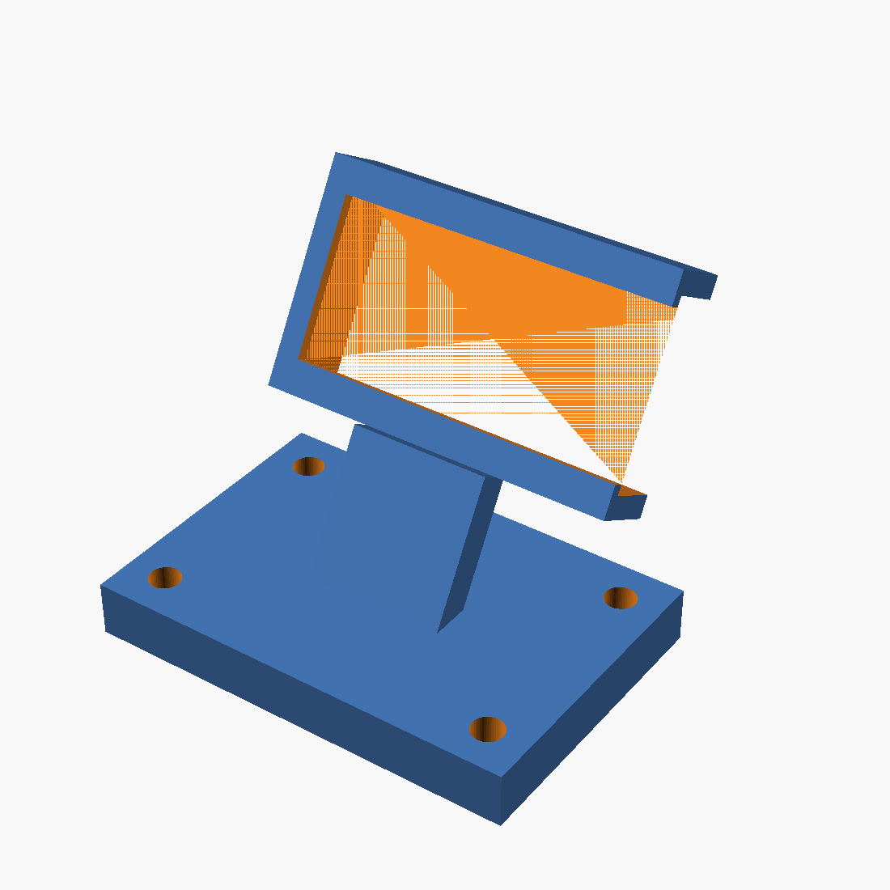

# Magnetic display stand

A 3D-printable stand for the LilyGo T-Display S3 AMOLED display **in its
case**, landscape orientation, tilted back for easy reading and held to the
espresso machine's steel body by 4 magnets - no screws into the case, no
adhesive on the machine.



## What you need

- **4x rod magnets**, 5 mm diameter x 8.47 mm tall, NdFeB N45 (as used when
  this was designed: [supermagnete.ch S-05-08-N](https://www.supermagnete.ch),
  ~1.1 kg pull each - roughly 4.4 kg combined, far more than the stand and
  case weigh). A different magnet size works too - edit `magnet_d` and
  `magnet_h` in `display_stand.scad` and re-render.
- A 3D printer, PLA or PETG. No supports needed if you orient the part with
  the cradle's flat back face down on the bed (rotate it in your slicer -
  the file itself is exported standing up, matching how it's used).

## How it holds the case

The case (58 x 30 x 10 mm, measured by hand) slides in from the right-hand
short edge - the same edge the USB-C cable exits - into a channel that
grips it by its two long edges and a closed cap on the left, with a ~1.6 mm
lip on the front face holding it in. Back and the right end stay open, so
the cable routes out sideways and nothing covers the screen.

This grips the case's outer envelope rather than fitting any internal
detail, since the case's own shape beyond its bounding box wasn't known
when this was built - works as long as the case is close to a plain
rectangular box. If your case has a different shape (rounded corners,
a lip, a stepped profile), check the fit before printing.

**Cable on the left instead?** Set `cable_exit_right = false;` near the top
of `display_stand.scad` and re-render - it mirrors the opening to the other
side.

## Dimensions and their source

Case outline: 58 x 30 x 10 mm, measured by hand - not from a CAD file, so
there's no sub-mm precision to rely on. `slot_clearance` (0.4 mm) and
`retain_lip` (1.6 mm) in `display_stand.scad` give it a bit of room; if
your case is a little larger or smaller, adjust `case_l`/`case_h`/`case_t`
at the top of the file and re-render.

## Customizing

Everything lives in named variables at the top of `display_stand.scad` -
`tilt_angle` (default 60°, measured from horizontal), `case_l`/`case_h`/
`case_t`, `cable_exit_right`, `base_w`/`base_d`, `magnet_d`/`magnet_h` for
different magnets, etc. Re-render after changes:

```bash
openscad --render -o display_stand.stl display_stand.scad
```

Two `assert()`s near the top check that the magnet pockets don't overlap
the strut pedestal if you change the base size, strut position, or magnet
spacing - they'll fail loudly with an explanation rather than silently
producing a broken part.

## Printing & assembly

1. Print `display_stand.stl` (PLA/PETG, 20%+ infill is plenty - it's not
   load-bearing beyond the case's own weight).
2. Press the 4 magnets into the pockets on the underside of the base
   (friction fit, ~5.3 mm holes for 5 mm magnets). Mind polarity isn't
   relevant here since there's nothing to match it against, just press
   them in flush.
3. Slide the cased display in from the open (cable) side until it seats
   against the closed cap.
4. Set the stand on the machine's steel body wherever you can read it.
